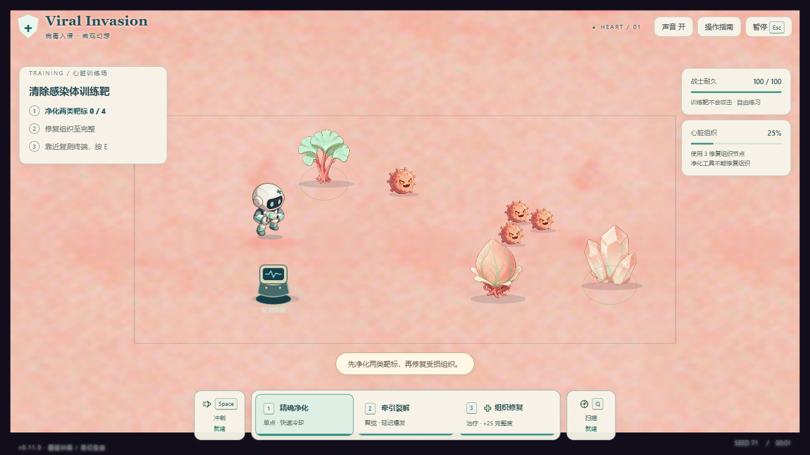
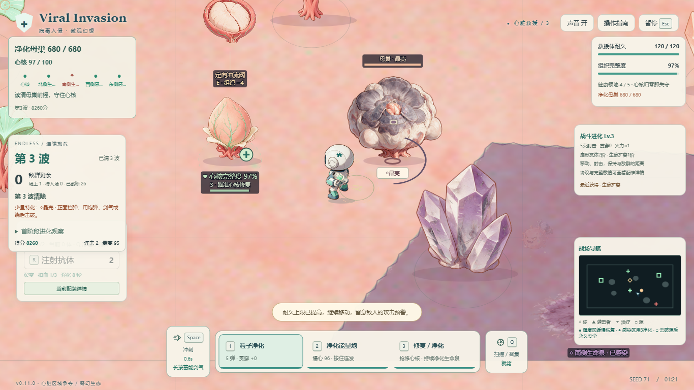

# 玩家与病毒整体风格自检 · v0.11.0

## 已确认的问题

用户反馈截图中的玩家、病毒仍接近旧版，要求彻底优化。核对运行图、选材和渲染路径后确认属实，不是截图缓存：上轮25项新素材只覆盖了场景。此前“风格统一”的交付表述超过了实际完成范围。

基线为v0.10.0的`game.js`，SHA256为`c440ca6bf74d40377677538e6c39a552b54c6c8af7a5ab8ddc12c2b51af7a170`。原始选材盘点及构建身份保存在`artifacts/actor-overhaul-20261103/initial-audit.json`和`baseline-build-meta.json`。

| 对象 | 原运行事实 | 本轮改造要求 |
|---|---|---|
| 玩家 | 旧batch10只有前右idle4帧；移动用固定像素关节点网格。旧动作候选与菜单`hero.selected`也保留在选材中 | 新奶白、灰蓝、薄荷医疗角色；宽阔色块、深面罩和短肢；前后两向配X镜像，真实待机/步行/受击/冲刺帧；菜单同步 |
| 普通与特化病毒 | batch08/09静图，发光核、长滴状触须和洋红硬亮边已烘入原PNG | 珊瑚/灰紫哑光圆团与短突起；眼口清楚。用喷口、前盾、双泡、披膜区分真实身份，移除发光刺线 |
| 侵染者与精英 | 主要靠标签和同body区分 | 新孢子背囊与菌角附件，保持实际晶壳/裂殖特征与危险信息 |
| 免疫小队 | 旧蓝白胶体与机器人灯塔，只有待机/咬击两姿态 | 奶白叶瓣小生命与低矮生根装置，双向爬行和咬击帧，不能像第二个主角 |
| 母巢 | 旧高饱和发光笼架，7静态层换态 | 新圆润生态母巢、集中弱点、呼吸/核心差分和真实战斗阶段驱动；核膜与特化层保持配准 |
| 特效与回退 | 旧扫描/治疗PNG、旧技能图标和局部程序演员仍会混用 | 统一药液颗粒、药团、剑气和图标画法；保留真实攻击边界。缺素材明确报告，不能暗中回到旧角色 |

## 素材与代码边界

继续采用批准概念图：`asserts/ViralInvasion_Fantasy_v1/references/territory-style-approved-v1.png`。上轮环境素材、所有原图和v0.10.0离线包保留。新演员只进入`asserts/ViralInvasion_Fantasy_Actors_v2/`，使用`fantasy.actor.*`运行ID；不对旧图整体降饱和来代替重新设计。

图片生成会话负责母图、连续帧或注册图层、真alpha、来源/提示词/runId/SHA256与增量交付。主会话负责最终选材和实际接入，先自检主角、普通病毒和细胞的同屏样板，再扩展完整家族。样板不是整套动画完成的证据。

正式交付合同：主角36帧（两向各idle4/walk8/hurt2/dash4）、6类敌体共48帧（每型walk4/windup2/hurt1/dissolve末态1）、免疫16帧（两向各crawl4/bite4）、独立喷射器/灯塔/角色附件4项、母巢11帧或层（base4/core2及5层），合计115项。关键姿态与程序过渡如实区分，不宣称均为完整手绘连续动画。

制作方法也须如实记录：AI母图、实际图像参考扩姿与本地分层/骨骼烘帧分别标明。本地rig烘帧不称为AI逐帧手绘；像素哈希不同不能证明动作充分，必须在真实显示尺寸看出腿部交替、预备/接触/回收或软体体积运动。仅微摆、缩放或加噪点的多个文件不能通过完整动作验收。

演员逻辑单帧512×512，脚锚(256,435.2)；母巢1024×1024，脚锚(512,870.4)。同身份共用逻辑尺度和完整画布，不按每帧alpha包围盒分别定高。每帧手握点、独立武器握点和枪口需记录并目检。运行采样按实际显示尺寸，资源JSON仍限20MiB，目标留出余量。

持枪审查发现原中立摊手与外侧手均不宜直接扩批：近手横向持枪穿身，外侧手镜像转向有约40CSS像素跳变。正式主角需重绘胸前居中的持枪预备姿态，并据真实手掌注册；不靠运行时切手、枪独立插值离掌或旧网格扭手掩盖问题。后坐围绕固定握把表现，与手部保持连接。

本轮只改变表现，不改变生命、伤害、敌群、碰撞、范围、胜负、存档规则；不加入装备、营地经营或新器官玩法。

小屏自检还发现原667×320正常相机约0.444，重绘后仍会把角色缩成小点。新增显式正常战斗比例下限0.62，仅触屏布局启用。可见角色高度按真实alpha内容与原生精灵计算，不能把完整透明画布当身体高度。早期身份样板的主角63.4CSS像素、r18普通体23.6、细胞21.7只是当时样板数据；正式36帧身体与工具包络已重新计算，并通过667×320及844×390的远距扫描预览与恢复检查。远距技能预览可按真实角色/落点联合包络临时拉远，结束后恢复可读比例。Y轴0.72投影、攻击距离和碰撞不变。

## 验收要求

1. 查看真实尺寸：主角、普通病毒与细胞分别在两种地面、1366×768/844×390/667×320及48体密度中检查。标签关闭的检查图里仍能凭轮廓区分身份，不仅靠颜色。
2. 检查全部动作组的身份、接地、画布、色板和循环接缝；记录实际帧而不是用ID数量冒充动画。主角四立绘视向与八方向移动分别说明。
3. 使用实际Renderer检查菜单、训练、心脏、肺部、标准/低特效和局部缺图回退。派生供态图明确标记，不冒充自然游玩；画面前后不改变模拟状态。
4. 自然DOM输入配合rAF追踪和连续录像，覆盖启停、八向走射、转向、冲刺、蓄能释放、扫描、修复/净化、真实受击与感染解除；检查短暂受击和死亡不会被单张截图漏掉。
5. 新冻结包重新验证完整救援、继续守卫、两个退出路径、离线加载与48体独占性能；核对实际源图、native frame、握点/枪口、回退原因和包哈希。

真实手机完整体验和5名新玩家盲测继续标为待人工验证。以下结果均来自本轮新构建，v0.10.0报告只用于历史对照。

## 本轮实际自检发现

- 移除旧角色、旧武器、旧扫描/治疗PNG和旧技能图标的运行选材；原始文件保留。代码仍保留隔离的旧版兼容入口，当前v2选择不能进入该分支。
- 逐帧原生渲染检查发现16项候选的动作组名缺少角色身份，导致文件齐全却只能显示00帧。已修正选材，并增加规范组名校验；后续检查反查真实图集帧，不只读取声明。
- 重新制作胸前持握姿态。前向主掌为源坐标(251.5625,305.2)，新版背向为(263.0625,305.7)；先前会产生约40CSS像素横跳的外侧手候选已退回。每帧保存实际握点，武器围绕握点后坐。
- 独立喷射器按实际alpha检查后采用96单位逻辑画布，小屏可见尺寸约21×14.5CSS像素。新角色取消旧的“向上时整枪藏在整个身体后”规则；实际前后朝向、动作与遮挡仍逐组验收。
- 晶壳用真实保护扇角acos(0.2)，暴露只认exposedUntil；薄射线方向来自冻结攻击计划。母巢剩余阶段层与短时暴露分别表达，阶段层仍在不等于全程无敌。低特效保留这些规则信息。
- 第一批过轻的动作已退回。新病毒以软体伸缩表现移动，细胞使用局部脚步与咬击，主角使用局部骨骼烘帧；母巢核心两态是状态差分，不称为运行中的逐帧循环。完整动作与单姿态过渡继续如实区分。
- 自然游玩还发现清波暂停时的诊断错报：实际显示帧冻结为walk/bite，记录却采用新的dissolve/guard请求。主体记录现以实际选中帧为准，当前意图另存；暂停验证核对上一实际显示帧，运行中仍独立依据生命、前摇与受击状态验证动作。

实际渲染的供态图、自然输入录像、整包离线运行及真机体验是不同证据。本轮已完成前面三类检查，真机及真人体验继续保留待验状态。

## 已冻结的集成版本

115项正式帧/图层已逐组核验并接入，四个母图预览绑定已移除。当前选材为132项精灵、8项环境，其中115项为本轮演员；旧版角色源图运行绑定为0。所有角色沿用同一套菜单、训练、心肺及回退分发，新菜单也按实际掌心接入独立武器。

源图冻结包含918张制作、原始与审核图，签名为`e032b2e87b2c439235a3cbca243c008efa11e5c5a3f6ef8de91cf9c12d12787b`；运行资源JSON为10,079,420字节（约9.61MiB），维持20MiB上限。完整36帧身体、工具瞄向及后坐包络为`[-48,48,-107.05,5.20]`，相机顶部包络扩至-112，保留显示余量。

暂停记录修复后的最终单元回归1606/1606通过，无跳过；其中全系统回归明确采用6个seed的限量检查，不是1000seed验证。TypeScript、源图冻结与构建身份校验通过。

## 最终整包结果（2026-11-03）

当前游戏脚本SHA256为`3ee2d91c62b5c1301d4260d8d47d231bf55384234c47fa2011d3b5cf15eb1f26`，构建校验287个输入。测试、选材和发行均核对同一脚本，不以旧截图或旧包代替。

全部证据与最终包身份集中在[最终验证索引](../artifacts/actor-overhaul-20261103/verification-summary.json)。

| 检查 | 实际结果与证据 |
|---|---|
| 单元与系统 | [1606/1606、0跳过](../artifacts/actor-overhaul-20261103/final-pause-unit.json)；[系统6个seed](../artifacts/actor-overhaul-20261103/final-pause-system-six-seed.json) |
| 桌面浏览器 | [原批22项中21过1失败](../artifacts/actor-overhaul-20261103/e2e-3ee2-report.json)，失败为启动指针被输入重置的测试时序；明确等待真实tick与新指针后，[Chrome/Edge四项定向复验全部通过](../artifacts/actor-overhaul-20261103/e2e-hero-startup-rerun-report.json)。共覆盖22个独立场景，不能相加成25项 |
| 可信触控事件 | [3/3通过](../artifacts/actor-overhaul-20261103/e2e-touch-cleanup-rerun-report.json)：双指移动/攻击独立释放、实际走路换帧、两种矮屏650距离扫描的身体/工具包络与取消恢复。平台是Windows Chrome/CDP，不是手机硬件 |
| 美术矩阵 | [final-5](../artifacts/actor-art-v2/final-5/report.json)：100组派生场景，115/115真实native资源、48方向例、16组48体供态图；缺图回退可观察，无缺失动作/视向、无旧演员运行帧 |
| 自然操作 | 同一final-5内8段公开DOM输入与录像；6段动作短流程，加precision/area两条完整救援（82.67/88.18模拟秒）。10类动作及4视向有实际帧记录；两条救援均覆盖感染、治疗、清感染、净化、特化出生、双源及母巢，页面与远程请求错误为0 |
| 继续守卫和记录 | [新包自然救援→继续守卫10秒→返回菜单](../artifacts/actor-overhaul-20261103/guard-3ee2/browser-report.json)通过，保存仍为1局、1次成功救援，同条记录补入守卫成绩；实际治疗与南区驻防也有回执 |
| 断网与发行 | [桌面ZIP独立解码](../artifacts/releases/v0.11.0/release-package.json)、[手机单HTML与ZIP精确比对](../artifacts/mobile-release/package-report.json)通过；[解压桌面与最终HTML断网启动、菜单持枪、移动、开始挑战和回菜单](../artifacts/actor-overhaul-20261103/final-offline-smoke.json)2/2通过，均无远程请求与页面错误 |

final-5中的通用`acceptanceStatus`仍把视觉审查和独占性能列为独立后置项目，原报告保持不改。主会话已目检最终实际尺寸图、前后持枪/转向接触页、角色家族/动作页、菜单与密集图；独占性能结果如下。该审查由Codex完成，不冒充真人审美评测。

| Windows Chrome独占压力（每组48活体约15秒） | 平均FPS | p95帧耗时 |
|---|---:|---:|
| 桌面／标准 | 59.93 | 16.8ms |
| 桌面／低特效 | 59.67 | 16.8ms |
| 触控布局／标准 | 59.80 | 16.8ms |
| 触控布局／低特效 | 60.00 | 16.8ms |

[压力原始报告](../artifacts/actor-overhaul-20261103/performance-3ee2/performance-report.json)记录自然清第一波、第二波停止射击聚敌再采样；活体及预约人口未超过48，源和产物未变。触控布局由键鼠驱动，观测开销计入帧时，没有强制GC；这不是手机硬件或600秒长期压力结果。

自然动作记录中player/tool逐rAF连续，敌场采用100ms及状态转变分层采样，不声称覆盖全部敌人的所有瞬态。`naturalSeconds=240`是时长上限，不是两次240秒完成记录。肺部覆盖派生Renderer矩阵，未完成自然入口全流程。

## 实际截图与交付

[同seed、同相机与同归一姿势的新旧对照](../artifacts/actor-overhaul-20261103/natural-comparison/comparison-v0.11.0-final-5.json)中，新图tick60、旧图tick61；时钟不同，不称为完全相同的模拟状态。

- [v0.11.0桌面离线ZIP](../releases/Viral-Invasion-G4-v0.11.0.zip)：7,993,608字节，SHA256 `54f5bd82820532d4b88ef15307ee4fd8be5a1c5d2f55e7823452956313b06fb7`。
- [最终手机单HTML](../releases/Viral-Invasion-Mobile.html)：12,398,432字节，SHA256 `45f392a1ede75ceafab87af1e1ede3080c68bb4bcd0d0b9dd2a8bdf2c9ff4a90`，与已测candidate-2完全相同；[手机ZIP](../releases/Viral-Invasion-Mobile.zip)另已独立解码比对。
- `releases/Viral-Invasion-Mobile-v0.11.0/`固定归档本次HTML、ZIP与包装报告；v0.10.0桌面、手机和原图保留。

尚待真实手机完整手感与旋转/后台体验、5名新玩家观察、肺部自然完整路线及长期压力。本轮自动化与Codex目检不代替这些结论。
