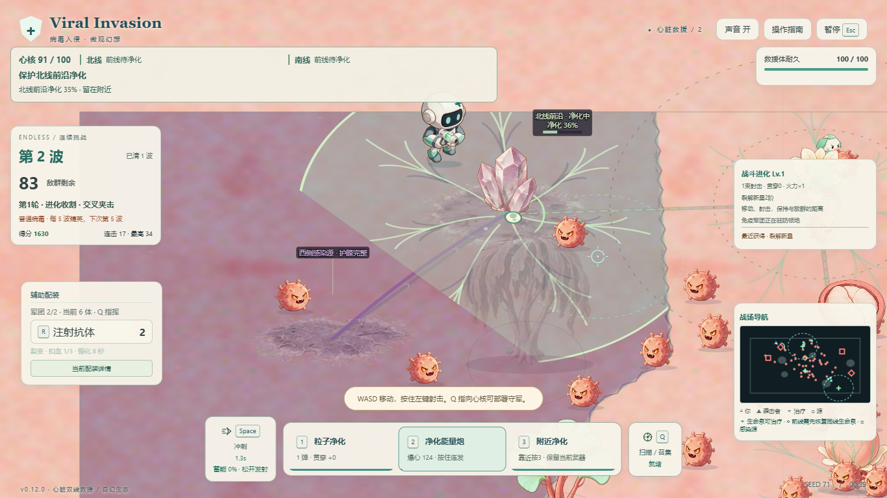

# 心脏双线攻防 · v0.12.0

## 解决的问题

旧五区玩法主要通过节点进度与完成后整片换色表现归属。只有两个早期出生位尝试侵染，生命泉争夺可以被直拆感染源绕过；工具3还要求精确点中设施。玩家难以判断感染正在发生在哪里，也缺少持续回防的理由。

本轮保留2400×1500、奇幻角色与场景、美术20MiB上限，以七区、两条明确战线、有限小队和上下文动作改造。首局5—8分钟是待真人验证的体验目标，不以固定波数或强制等待锁住通关。

## 双线与反攻

| 路线 | 病毒推进顺序 |
|---|---|
| 北线 | 西感染源(450,600) → 北线前沿(700,350) → 北侧生命泉(1150,330) → 心核(1200,900) |
| 南线 | 东感染源(1950,450) → 南线前沿(2140,950) → 南侧生命泉(1880,1300) → 心核 |

心核和两泉初始健康，两前沿和两源初始感染。前沿是可争夺组织，不提供治疗。侵染者沿其路线寻找健康节点，在120范围累计10秒占领，数量不加速；没有侵染者时，未完成进度每秒回退10个百分点。完全失守后需要玩家主动净化。

后续小队从该线最靠近心核的感染节点附近出发。心核只受真实抵达后的攻击伤害，没有离屏隐藏扣血。普通敌人、护卫不染地；侵染者专注占点，护卫负责保护队长并干扰玩家，队长死亡后追击玩家。

第3波进入战斗后出现1200基础耐久感染源。只有对应泉与前沿均健康时，供能护膜才解除；任一失守会复膜，但源剩余耐久保留。所有伤害途径均经过同一护膜判定。击破源后该区永久健康、停止该线新小队；已出生敌人仍需清理。双源清除、完成本波剩余义务和强化后进入原母巢战。

## 有限进攻与操作

每队1名侵染者和3名护卫，替换等量普通出生预算，不增加无限生成器。第1波北线1队、第2波北南各1队、第3波起北南北南各1队；首队计划在进入战斗4秒后出发，实际出发间隔至少10秒，每次预警至少4秒。每线最多1支存活小队，护卫也属于队伍存活成员。

队伍为原子4体出生，普通出生为待发线路让出必要人口，活体、源/母巢和预约裂殖合计不超过48。专职队使用有预警的独立出生环，避免站住感染节点就永久阻止出兵；位置、人口或同线成员阻塞时保留任务重试，显示集结，不退回普通病毒。源毁取消该线未出生任务并计入取消预算；双源取消和清波不会重复结算。

- **桌面3／手机“附近净化”**：150范围优先启动最近可净化组织，保持当前攻击武器，不要求精确瞄准。前沿需要对应生命泉健康，泉失守时先夺回泉。
- **净化3秒**：可移动射击；离范围、侵染者进入或上游泉失守时暂停，保留进度并显示实际原因。受伤不清空。
- **附近没有净化目标**：可修复150范围内的受损心核，沿用25修复量及0.7秒冷却，不给玩家额外回血。无目标显示靠近提示。
- **Q／免疫**：瞄准健康节点驻防，最多两支有生命军团。优先拦截对应战线的侵染者，实际走路咬击，不能代替玩家净化。
- **生命泉**：健康时150范围每秒恢复3耐久，连续停留1秒清感染。完全失守后停止，治疗不叠加。

玩家或心核归零失败；胜利快照立即保存。继续守卫保留成长和军团，边缘有限增援复用两线，不复活源；后续失败不撤销救援。

## 画面与记录

健康使用暖珊瑚和薄荷脉络；静态感染使用紫灰菌毯与断脉。真实侵染按攻击者方向和进度形成推进切面，净化按进度扩散复苏覆盖。稳定归属地面缓存只随归属等必要输入更新，区域几何不因进度、暂停或归属切换重算。

顶部集中显示心核、北线、南线和一个目标；附近只保留一个上下文提示。实际受袭优先，预定队伍显示中性的准备时间，阻塞显示集结；静态感染不报警，屏外箭头只用于实际受袭。世界节点只保留短状态与图形进度，出生预算等诊断默认隐藏。玩家耐久和战斗成长继续保留。

新记录使用`viral-invasion:3:territory-profile`，旧五区`:2:`与旧无尽`:1:`只读取存在性，不迁移、不覆盖、不混排。仍不提供刷新恢复战场。

## 当前验证状态

- 根会话接线/护膜/净化/军团/存档定向50项通过；规则与队列定向74项、表现相关121项通过。这些是交叉覆盖，不能与全量数量相加。
- 全量首轮1652项中7项因并发CPU负载超时；保留原报告。限定2个worker、保持原超时门后恢复通过；最终candidate4新用例纳入后，[1663/1663通过、0跳过](../artifacts/dualfront-20261103/unit-c4-final.json)，系统检查仅6个seed，TypeScript通过。
- 最终candidate4：[手机单HTML的Chrome可信触摸/净化/角色7项](../artifacts/dualfront-20261103/e2e-mobile-final/report.json)、[Chrome/Edge入口/三尺寸/旋转/独立战绩10项](../artifacts/dualfront-20261103/e2e-entry-final/report.json)，合计17/17通过、无跳过。锁定实际HTML与脚本哈希，开局无假0%、准备倒计时中性、当前净化目标正确；离150范围暂停、返回恢复，主武器与持续射击保留。可信三指事件来自Windows Chrome/CDP，不是手机硬件。
- 纯GameSession核心防守测压共3个seed×有/无基础双军团。玩家只主动攻击追击者及护卫，不主动瞄侵染者，不净化、拆源、修复或补军团。双军团均有实际两次成功部署；三组北泉在45.02、69.30、71.10秒失守，说明需要主动回防。它不是浏览器、真机或真人手感证据。

压力报告：`artifacts/dualfront-20261103/pressure-core-defense/pressure-report.json`。初始“只射普通且排除护卫”策略在清完普通后停止开火、风筝两只残留护卫，不能用于证明永久防守；该原始和诊断报告保留，未据此削弱军团。

真实手机完整体验、5名新玩家在3秒内辨认受袭区域，以及成功局5—8分钟目标均待人工验证。

阶段性真实整局：candidate3的精确攻击／晶壳路线通过，公开键鼠操作实际净化两前沿，南前沿失守后再次夺回，完成双源、母巢、继续守卫10秒及返回菜单；同一条v3记录保留救援和守卫成绩。胜利121.93模拟秒、退出132.4秒，是熟练脚本约2分钟的结果，不能代表新玩家5—8分钟。该报告保留在`artifacts/dualfront-20261103/natural-c3-first/browser-report.json`。

截图审查也找出并修正假0%净化提示、净化南线却推荐北线目标、前沿晶体挡住角色和小屏屏外警报被HUD挤掉等问题。以下最终候选与报告均覆盖这些修正，前一轮数量不充当最终结果。

## 最终构建与发行

已完成最终candidate4并逐字节同步到`dist/`。脚本SHA256为`b33bee84c74e5bd7a6b42ea8113eb2b0d4db51d73db8fe7f9daa3ce6c7e4855d`，287个构建输入全部匹配；运行美术JSON仍为10,079,420字节（约9.61MiB），没有放宽20MiB上限。[最终验证索引](../artifacts/dualfront-20261103/verification-summary.json)集中记录身份与报告。

- [最终自然范围攻击／裂殖路线](../artifacts/dualfront-20261103/natural-final-area-2/browser-report.json)通过：两泉均有真实军团到场，先对东源带膜实射1.12秒、耐久保持1200且有实际挡伤回执，再净化前沿、解膜；两源各自实际伤害累计1200，击败裂殖母巢，继续守卫10.25秒并主动结束。胜利133.97模拟秒、结束144.22秒，同一UUID仅计1局、1次救援，峰值48活体/预约人口，无页面错误，源码与产物未变。护膜随再次失守恢复的边界另由规则和会话测试覆盖。
- 初次final-area报告保留为失败证据：脚本在第3波预警期间提前净化南前沿，虽完成整局却没有执行带膜实射，末尾严格验证失败。只修复脚本策略后另目录重跑，未改游戏或放宽验收。
- [最终视觉报告](../artifacts/dualfront-20261103/visual-review-c4/report.json)和[目检记录](../artifacts/dualfront-20261103/visual-review-c4/REVIEW.md)：78组供态Renderer截图、3个自然入口，1366×768／844×390／667×320、标准与低特效覆盖。实际viewport、Canvas尺寸和PNG尺寸逐项一致；前沿重叠透明度合成0.22，离开恢复；真实屏外受袭存在箭头、静态感染无箭头且避让实测HUD。进度变化不重建归属地面或区域几何。供态图不冒充自然完整对局或真人视觉测试。
- [48人口独占性能](../artifacts/dualfront-20261103/performance-final/performance-report.json)：四组自然清第一波、第二波聚敌后各采样约15秒，始终48活体且预约人口≤48。平均FPS为桌面标准59.67、桌面低特效59.73、触控布局标准59.93、触控布局低特效59.40，p95均16.8ms，最慢单帧50ms；源与产物未变、0错误。这是Windows Chrome、键鼠驱动触控布局，未测手机硬件或长期运行。
- [桌面ZIP独立解码比对](../artifacts/releases/v0.12.0/release-package.json)、[手机HTML/ZIP精确比对](../artifacts/mobile-release/package-report.json)、[最终解压桌面与HTML断网启动](../artifacts/dualfront-20261103/final-offline-smoke.json)全部通过；后者2/2检查实际菜单/玩家/工具新资源、开始挑战、真实移动和回菜单，无远程请求或页面错误。

| 发行物 | 大小与SHA256 |
|---|---|
| [v0.12.0桌面离线ZIP](../releases/Viral-Invasion-G4-v0.12.0.zip) | 8,003,045字节；`1bbd53e1a77ce5d316911891927bbad04a161ecddefb1005b04e2b362d424da2` |
| [手机单HTML](../releases/Viral-Invasion-Mobile.html) | 12,427,006字节；`0873cc98f50402e5c2d993d9976caece010f4af0fe5c0661aff373583785405a`，与已测candidate4完全相同 |
| [手机ZIP](../releases/Viral-Invasion-Mobile.zip) | 7,986,024字节；`d1d5d381341d75739ba2bd84bed42696cccc43fa80af3e5beb8378798003bbc8` |

手机固定归档位于`releases/Viral-Invasion-Mobile-v0.12.0/`，旧版桌面、手机与批准概念原图保留。本轮不提交或推送Git。
