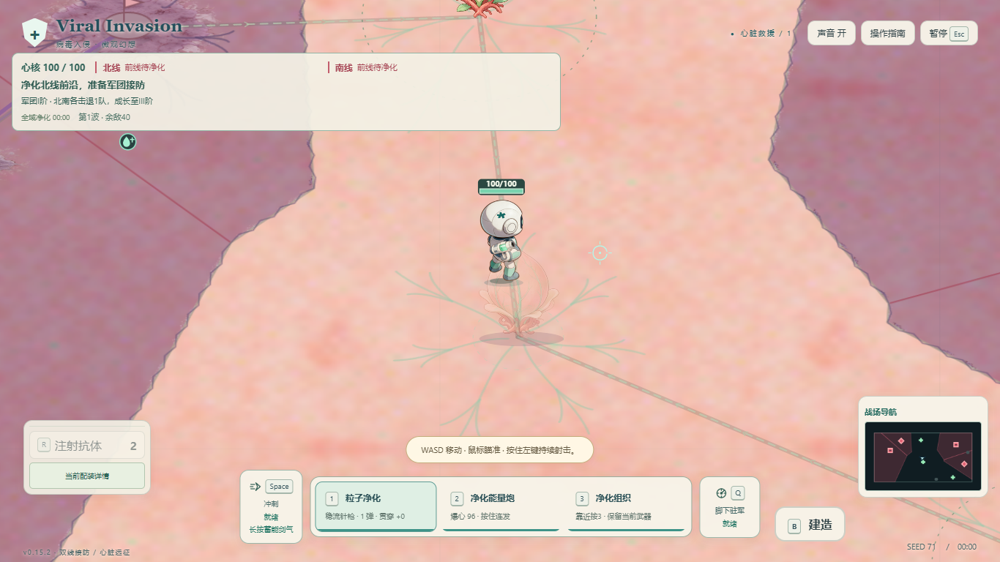
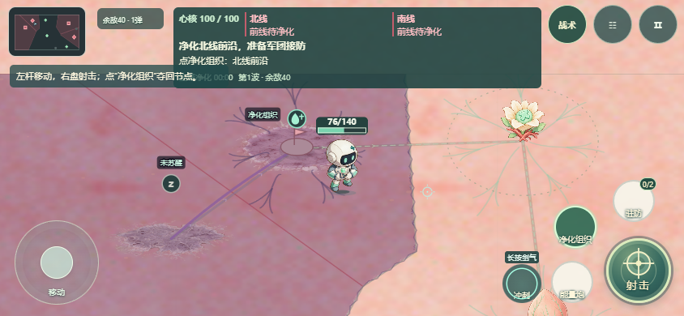
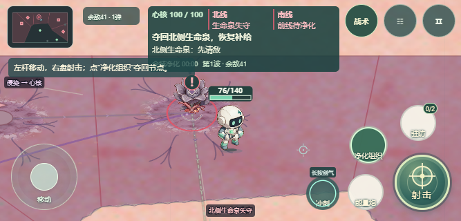

# v0.15.3：战场识别与通行优化

2026-11-04。基于v0.15.1并保留同工作区的营地入口／结算修复，统一交付v0.15.3。保留v0.15.1、v0.15.2旧包。没有新增位图素材。

## 操作识别

- 画面内被感染的组织常驻薄荷水滴与星芒；进入150范围后显示桌面“3 净化”或手机“净化组织”。不再要求440以内才有目标状态图标。
- 灰锁及短原因区分先清敌、先夺回对应生命泉、受击暂停、弹射中等真实限制；净化中显示百分比及外圈真实进度，暂停保留进度。
- 双源分别显示休眠、源膜锁、红色射击准星。已摧毁源和健康节点收起常驻操作标识；源的射击与组织净化不混用。
- 标识、HUD和地图读取同一只读目标视图；可用性直接复用生产净化阻断和源膜判定，没有放宽净化、接防或通关条件。

## 血量、感染与镜头

- 玩家头顶固定CSS尺寸的64×22读数底板，内含60×7血条及当前／实际最大耐久。正常薄荷、低血琥珀、濒危红色，沿用既有阈值与恢复迟滞。
- 锚点使用Phaser当前真实玩家身体边界；Canvas使用实际回退轮廓。弹射高度计入身体与镜头安全框。先为血条预留标签区域，最后绘制，防止角色、场景和普通标签盖住血量。
- 默认心脏战斗HUD收起角落重复血条，战况详情保留数值。普通敌人伤血后可显示血条，关键敌人和瞄准目标保留必要读数，密集标签按原优先级避让。
- 感染区域增加淡红覆盖和边界；小地图显示红色实心节点及区域，同时保留泉十字、前线菱形、源方框。
- 实际开始受侵染时提醒2秒，实际失守提醒3秒，随后稳定标红。时间记录在本局节点，按模拟时间计算；暂停冻结，净化后清除，新局重置。开局已有感染区不误播“刚失守”。低特效保留静态红圈、图标和地图颜色。
- 修正关闭的details战术菜单仍返回子节点矩形的问题，避免未显示的菜单被当作血条与标签的遮挡区。

## 通行与掩体

- 新版心脏挑战使用独立TERRITORY_WORLD；旧战役心脏5处、肺部4处障碍布局保留。
- 普通障碍5→2：南侧(1500,1350)、东侧(2220,650)，半径均40。改用低矮组织隆起，底盘与圆形碰撞一致；角色被遮挡时淡化。
- 双前线改成低矮地台和小旗，位置、净化范围、状态归属不变。
- 玩家、敌人、军团、弹丸及地图统一读取activeWorld。回归逐段采样验证双线连接中心两侧各100世界单位净空，并检查掩体仍阻挡移动与射击。

## 同步保留的营地修复

同工作区另一会话负责的改动一起入包：主菜单独立营地入口，真实成功后结算可回营，失败／撤离／已成功后结束守卫分开呈现。只有真实成功凭证或已解锁档案允许营地入口，不因失败发奖励。

最终补充修正通用保存状态：成功、失败均使用中性“本次挑战记录已保存。”；成功仍由真实成功凭证说明，失败不再出现“救援成果已保存；继续守卫不会撤销成功”。已补玩家／心核实际归零后经过真实持久化存储的结算断言。

## 验证证据

冻结交付：`artifacts/readability-v0153/candidate-final-3`。API `0.15.3-readability`。meta SHA256 `4c56bc52f08fa0d7cfdb8e5353aab777a3e02d83ab0bb777c0b4da14ed9fa83b`；game.js SHA256 `32e68a304beb6c4416ab8816303d802133e9ac065f4bf27e3bd3078805e7f8bc`。

以下完整画面矩阵与定向入口以候选2为行为验证身份。交付候选3只修正三处可见footer版本号：源清单唯独main.ts改变，候选2的game.js精确替换这三处等长字面量后与候选3逐字节相等，index.html和game.css不变。[等价核验](../artifacts/readability-v0153/footer-equivalence.json)保留两份候选，未冒称旧HTTP响应就是新候选响应。

| 检查 | 结果 |
|---|---|
| 类型 | 最终TypeScript检查通过。 |
| 全套单元／模拟 | [1911/1911通过、0跳过](../artifacts/readability-v0153/unit-results.json)，4个并发worker；完整会话检查明确限[6个seed](../artifacts/readability-v0153/system-six-seeds.json)。最后中性保存文案修改后另跑[66/66档案、营地和HUD测试](../artifacts/readability-v0153/camp-profile-final.json)。 |
| Chrome | [最终报告](../artifacts/readability-v0153/chrome-final/browser-report.json)：1366×768、844×390、667×320各真实开局移动射击，手机使用CDP可信双指；72组普通／低特效受控状态画面、9组Canvas回退检查通过，页面错误0。 |
| Edge | [最终报告](../artifacts/readability-v0153/edge-final/browser-report.json)：同上3组实际输入、72组受控状态及9组回退通过，页面错误0。 |
| 交付候选3真实开局 | [Chrome](../artifacts/readability-v0153/chrome-candidate3/browser-report.json)和[Edge](../artifacts/readability-v0153/edge-candidate3/browser-report.json)各3尺寸实际移动／射击／血条避让通过，明确断言可见版本号v0.15.3，页面错误0。 |
| 营地定向联验 | 候选2的[原报告](../artifacts/camp-entry-v0152/final-v0153-limited-probe/report.json)：844、667两档实际敌人致死、重试和返回菜单行为通过，8项生产markup/CSS组件入口通过。原报告pass=false原样保留：运行中main.ts发生已证明的footer字面量修正，精确源稳定性条件未满足；实际HTTP输出稳定。总核验通过明确限定范围和字节等价衔接，不把它改写成候选3整局自然证据。 |
| 图像与状态 | 受控场景覆盖可净化、前置受阻、进行中、暂停、开始污染、失守、源膜、可射击源、飞行、低矮掩体、濒危和48敌人；验证绘制不写游戏状态、血条不越界或与HUD相交，并采样实际小地图像素为红色。 |
| 渲染样本 | Chrome 844×390下48体受控画面15秒，143.60 FPS、p95帧间隔7.2ms。本项只测本机渲染，不是完整战斗模拟或实体手机性能结论。 |
| 包体与一致性 | [发布身份](../artifacts/readability-v0153/release-identity.json)：462项输入哈希与冻结候选一致；桌面ZIP独立解码，全部5项逐字节匹配。手机[最新包](../artifacts/readability-v0153/mobile-latest-final.json)及[版本归档](../artifacts/readability-v0153/mobile-archive-final.json)独立解码，HTML哈希一致。 |

离线资源[静态核验](../artifacts/readability-v0153/offline-static.json)通过：精确重组手机HTML、匹配归档、19处内嵌PNG、无外部资源引用。动态浏览器验证范围为白名单本地HTTP，本轮不宣称重新做了file协议动态启动。当前最终候选的完整自然通关驱动两次遇到路线假设失败，原报告保留；不把它们写成通过。实际结算／营地采用定向真实死亡和显式组件验证，其独立结果在总验证索引列明。

首轮默认并发测试已中止，后续高并发尝试出现超时及两项旧视觉断言不适配；原记录保留在`artifacts/readability-v0152`。更新旧断言并限制并发后得到上述1911项通过。实体手机及新玩家理解度仍需实测。

最终[8项总核验通过](../artifacts/readability-v0153/verification-summary.json)，包括当前462项源哈希、交付身份、完整回归／66项补充、双浏览器画面与当前开局、footer字节等价、限定营地行为、离线自包含、最终类型与diff检查。

## 前后画面与交付

旧版开局与新版自然开局：

新版可净化组织、头顶血条及低矮前线地台（受控状态）：

新版失守红圈、小地图感染区和头顶血量（667×320受控状态）：

- [桌面离线ZIP](../releases/Viral-Invasion-G4-v0.15.3.zip)：解压后打开index.html或Open-Game.cmd。
- [手机单HTML](../releases/Viral-Invasion-Mobile.html)／[手机ZIP](../releases/Viral-Invasion-Mobile.zip)，同版归档在`releases/Viral-Invasion-Mobile-v0.15.3/`。
- 工作区双击Start-Game.cmd也使用本版构建。

保留已有工作区改动，本轮没有提交或推送。
