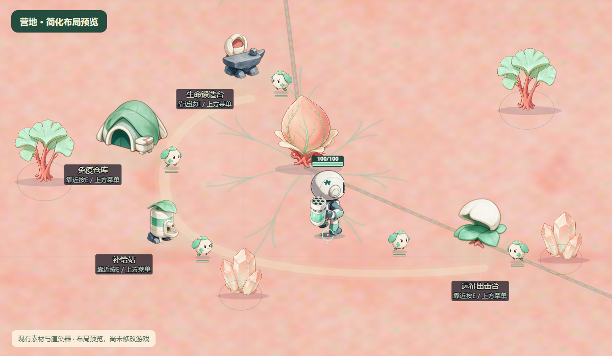

# 营地简化布局 v2

按用户反馈，收敛到当前游戏实际风格。此版使用项目现有 Renderer、粉色地面、四设施、心核、细胞、脉树与水晶素材渲染，作为布局预览；没有修改生产源码，没有新增生成美术。

四设施仍保持原尺寸和造型，改为围绕心核的开放短弧：仓库左侧、锻造左上、补给左下、出击右下。相对心核坐标分别是(-280,-30)、(-100,-200)、(-230,170)、(280,180)。锚点范围从350×215扩展为560×380，中心保留移动空间，右上保持开放。

只加一条低对比淡色地表脉络、设施下浅色落脚区域、两棵现有脉树、两簇现有水晶。五名常驻细胞分散在设施旁和出击路径上。树木、水晶和细胞均使用当前资产；没有增加建筑群、围墙、铺砖广场或大型门户。

此图是隔离的静态设计场景。细胞的移动与工作行为尚未实施；设施交互距离、完整路径与手机镜头需要落地时验证。预览脚本只在内存构建中替换布局、添加地表笔触和提供场景状态，生成前后检查生产文件哈希一致。

## 图件与复现

- `simple-camp.png`：新方案。
- `current-camp.png`：同镜头的当前四设施布局参考，来自单独提供的营地状态，不是用户存档或自然游戏过程。
- `preview-report.json`：渲染结果、草案坐标、页面错误与源码未变检查。
- `render-preview.mjs`：在项目根目录执行 `node Docs/camp-redesign-20261105/simple-v2/render-preview.mjs` 可重新生成。

上一版 `../camp-concept.png` 和 `../camp-layout.svg` 为复杂方案历史稿，本次不再沿用。
