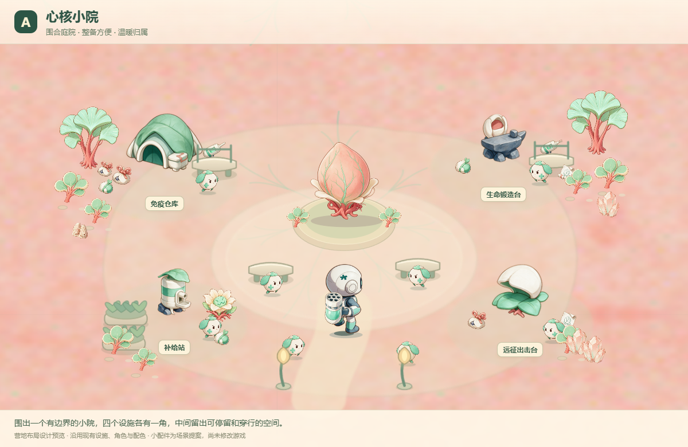
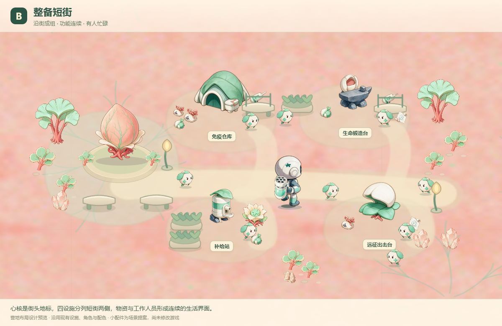
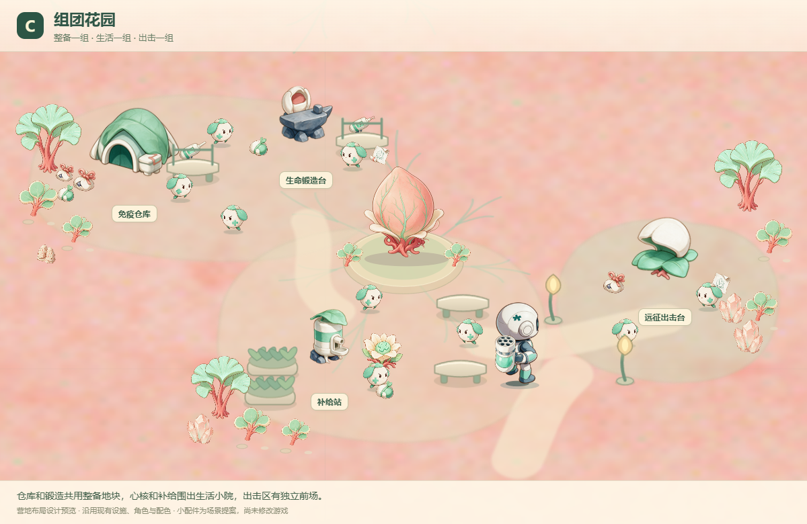

# 营地三方案 v3

2026-11-05。根据“复杂方案过满、简化方案过空”的反馈，本轮将丰富度放在设施周围的小场景与居民活动上，提供三种空间组织，而不是同一布局的三次换位。

| 方案 | 空间特点 | 吸引点 | 取舍 |
| --- | --- | --- | --- |
| A 心核小院 | 四设施围合中心庭院，南侧进出 | 心核主景、休憩座凳、完整小院边界 | 整体最集中，视觉较规整 |
| B 整备短街 | 心核在街头，设施沿短街两侧展开 | 搬运、修复、备货和出击沿街可见 | 生活感强，横向距离较长 |
| C 组团花园 | 左上整备、中下生活、右侧远征 | 每组都有不同小景，粉色地面分隔组团 | 分区自然，镜头需要兼顾多个焦点 |







## 本轮共同设计

- 保留当前粉色组织地面、四设施、心核、角色造型及其原有尺寸比例。
- 仓库旁有物资袋和武器陈列；锻造旁有材料、待修复武器和图纸；补给旁有药圃和恢复花；出击旁有行装和小晶体标识。
- 每区物件集中在侧面，门前和主要通路保持清楚。植物按簇摆放，维持高树、低灌木、物资三层高度。
- A/B/C分别提供8/10/9名常驻细胞的静态位置；行为尚未实施。休憩和工作姿态在后续角色表现阶段细化。
- 营地预览中不显示战斗血条、远方节点与战斗连线；设施采用简洁名称标签。
- 地表以柔和的庭院、短街或组团地块组织空间，保留现有粉色底色，未画成完整村庄插画。

## 素材和实现边界

三图通过当前游戏 `Renderer` 和现有 sprite 美术渲染。设施、角色、物资袋、生质包、图纸、武器、植物与恢复花都来自现有项目资源。座凳、陈列台、短灯、种植盆和地表由预览代码绘制，是尺寸与场景关系的提案；正式落地时可配套制作匹配手绘笔触的小配件美术。

本轮只添加设计目录，没有修改游戏源码、存档或平衡参数。预览中的物资不代表可拾取奖励，常驻细胞不代表已实现营地行为。完整交互、碰撞通行、镜头跟随和手机显示尚未实施验证。

## 复现与检查

在项目根目录运行：

```powershell
node Docs/camp-redesign-20261105/variants-v3/render-variants.mjs
```

该脚本在内存构建中替换布局和提供静态场景，临时HTML生成后清理。`preview-report.json` 记录三张截图的坐标、居民数量、道具数量、页面错误及生产文件生成前后的哈希；本次三图均无页面错误，所触及的生产文件哈希一致。

本轮检查为图像与渲染检查，不声称通过自然游戏流程、实际居民行为或碰撞路径测试。
